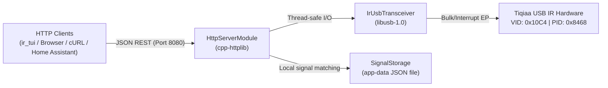

# `ir_api` — Embedded HTTP REST API Server

The `ir_api` module provides an embedded, cross-platform HTTP REST API server for the IR Transceiver application. Powered by modern C++17, [`cpp-httplib`](https://github.com/yhirose/cpp-httplib), and [`nlohmann/json`](https://github.com/nlohmann/json), it enables remote clients, home automation systems (Home Assistant, Node-RED), web dashboards, and the console test tool (`ir_tui`) to control hardware transmission, monitor connection states, read captured signals, and manage saved remote control profiles over standard HTTP JSON endpoints.

---

## 📑 Table of Contents

- [Architecture Overview](#-architecture-overview)
- [Prerequisites & Dependencies](#-prerequisites--dependencies)
- [Building & Running](#-building--running)
- [CLI Options & Configuration](#-cli-options--configuration)
- [📡 API Endpoint Reference](#-api-endpoint-reference)
  - [1. Service Info (`GET /`)](#1-service-info-get-)
  - [2. Transceiver Status (`GET /api/v1/status`)](#2-transceiver-status-get-apiv1status)
  - [3. Transmit IR Signal (`POST /api/v1/send`)](#3-transmit-ir-signal-post-apiv1send)
  - [4. Read Receive Buffer (`GET /api/v1/receive`)](#4-read-receive-buffer-get-apiv1receive)
  - [5. Single-Shot Capture (`POST /api/v1/capture`)](#5-single-shot-capture-post-apiv1capture)
  - [6. Hardware Mode Control (`POST /api/v1/mode`)](#6-hardware-mode-control-post-apiv1mode)
- [Status & Error Codes](#-status--error-codes)
- [💡 Practical Usage Examples](#-practical-usage-examples)
  - [Terminal Console Client (`ir_tui`)](#terminal-console-client-ir_tui)
  - [cURL Command-Line Examples](#curl-command-line-examples)
  - [Python Client Script (`requests`)](#python-client-script-requests)
  - [JavaScript / Browser Fetch Example](#javascript--browser-fetch-example)
  - [C++ Client Example (`cpp-httplib`)](#c-client-example-cpp-httplib)
- [License](#-license)

---

## 🏗 Architecture Overview



### Key Highlights
* **Zero Overhead & Non-Blocking:** Runs on a dedicated background listener thread without freezing your GUI or main execution flow.
* **CORS Support:** Built-in Cross-Origin Resource Sharing (`Access-Control-Allow-Origin: *`) enables seamless web application and dashboard integration.
* **Dual Protocol Input:** Transmit signals via high-level NEC hex words, explicit `address`/`command` pairs, raw microsecond pulse arrays, or saved signal names.
* **Automatic Decoding & Matching:** Captured signals are parsed in real time, decoded as NEC protocols if applicable, and automatically compared against your stored signal catalog.

---

## 📦 Prerequisites & Dependencies

The REST API module requires the following development packages:

* **HTTP Engine:** `libcpp-httplib-dev` (header `<httplib.h>`, version >= 0.18)
* **JSON Processing:** `nlohmann-json3-dev` (header `<nlohmann/json.hpp>`, version >= 3.2.0)
* **USB Driver:** `libusb-1.0-0-dev`

### Debian / Ubuntu Installation
```bash
sudo apt update
sudo apt install build-essential cmake libusb-1.0-0-dev libcpp-httplib-dev nlohmann-json3-dev
```

> [!NOTE]
> If `libcpp-httplib-dev` or `nlohmann-json3-dev` are not installed on your system, the project CMake configuration will automatically fetch and compile them via CMake `FetchContent`.

---

## ⚙️ Building & Running

### Building the Server & Tests
```bash
mkdir -p build && cd build
cmake --build . --target ir_api_server test_all --parallel
```

### Running the Standalone API Server
```bash
./src/api/ir_api_server --port 8080 --host 0.0.0.0
```

### Running the Unified Unit & Integration Tests
```bash
./tests/test_all
# Or via CTest:
ctest --output-on-failure
```

---

## 🖥 CLI Options & Configuration

The standalone server binary `ir_api_server` accepts command-line parameters:

| Flag | Parameter | Default | Description |
| :--- | :--- | :--- | :--- |
| `-p`, `--port` | `<port>` | `8080` | Port to listen for incoming HTTP connections |
| `-h`, `--host` | `<host>` | `0.0.0.0` | Bind IP address (`0.0.0.0` for all interfaces, `127.0.0.1` for local only) |
| `-s`, `--storage` | `<path>` | `~/.config/IR/saved_ir_signals.json` or `%APPDATA%\IR\saved_ir_signals.json` | Path to the local JSON signal database used by the desktop apps |
| `--help` | — | — | Displays CLI help message |

---

## 📡 API Endpoint Reference

The default base URL is `http://localhost:8080`.

| Method | Endpoint | Description |
| :--- | :--- | :--- |
| `GET` | `/` | Service identification and endpoint directory |
| `GET` | `/api/v1/status` | Transceiver hardware connection and operational state |
| `POST` | `/api/v1/send` | Transmits an IR signal (NEC code or raw pulse timings) |
| `GET` | `/api/v1/receive` | Pops the oldest signal from the FIFO receive buffer |
| `POST` | `/api/v1/capture` | Synchronously waits for an incoming IR signal with a timeout |
| `POST` | `/api/v1/mode` | Sets transceiver operating mode (`idle`, `receive`, `start_polling`, `stop_polling`) |

---

### 1. Service Info (`GET /`)

Returns API metadata and registered endpoints.

#### Response `200 OK`
```json
{
  "service": "Multi-Platform IR Transceiver REST API",
  "version": "1.0.0",
  "documentation": "/api/v1/status",
  "endpoints": { ... }
}
```

---

### 2. Transceiver Status (`GET /api/v1/status`)

Queries the native USB transceiver state and hardware descriptors.

#### Response `200 OK`
```json
{
  "connected": true,
  "state": "Idle",
  "device": {
    "vendorId": "0x10C4",
    "productId": "0x8468",
    "manufacturer": "Silicon Labs",
    "product": "Tview USB IR",
    "serialNumber": "0001",
    "firmwareVersion": "V1.0",
    "defaultFrequency": 38
  },
  "savedSignalsCount": 3
}
```

---

### 3. Transmit IR Signal (`POST /api/v1/send`)

Encodes and transmits an IR signal via the hardware transceiver.

#### Option A: NEC Protocol by 32-bit Code
```json
{
  "protocol": "NEC",
  "code": "0x00FF45BA",
  "frequency": 38
}
```

#### Option B: NEC Protocol by Address & Command
```json
{
  "protocol": "NEC",
  "address": "0x00",
  "command": "0x45",
  "frequency": 38
}
```

#### Option C: Raw Pulse Timings (Microseconds)
```json
{
  "protocol": "Raw",
  "frequency": 38,
  "pulses": [9000, -4500, 560, -560, 560, -1690, 560, -40000]
}
```

#### Option D: Stored Signal by Name
```json
{
  "name": "TV Power"
}
```

#### Successful Response `200 OK`
```json
{
  "success": true,
  "message": "NEC signal transmitted successfully",
  "protocol": "NEC",
  "code": "0x00FF45BA",
  "pulseCount": 68,
  "frequency": 38
}
```

#### Failure Response `503 Service Unavailable`
```json
{
  "success": false,
  "error": "USB Transceiver is not connected"
}
```

---

### 4. Read Receive Buffer (`GET /api/v1/receive`)

Pops the oldest received signal from the internal thread-safe `RingBuffer`.

#### Query Parameters
* `last=true` *(optional)*: If the buffer is empty, returns the last cached captured signal instead of an empty notice.

#### Response `200 OK` (Signal Available)
```json
{
  "available": true,
  "signal": {
    "frequency": 38,
    "pulseCount": 68,
    "timestamp": "2026-10-10 18:30:15",
    "pulses": [9000, -4500, 560, -560, 560, -1690, 560, -40000],
    "decoded": {
      "protocol": "NEC",
      "rawValue": "0xE718FF00",
      "address": "0x00",
      "command": "0x18",
      "isRepeat": false
    },
    "matchedSavedSignal": "TV Power"
  }
}
```

#### Response `200 OK` (Buffer Empty)
```json
{
  "available": false,
  "message": "Receive buffer is empty"
}
```

---

### 5. Single-Shot Capture (`POST /api/v1/capture`)

Blocks the request until the user presses a remote control button or the specified timeout expires.

#### Request Body *(optional)*
```json
{
  "timeout": 8.0
}
```
*(Can also be supplied via query parameter: `/api/v1/capture?timeout=8.0`)*

#### Response `200 OK` (Captured)
```json
{
  "success": true,
  "signal": {
    "frequency": 38,
    "pulseCount": 68,
    "pulses": [9000, -4500, 560, -560, ...],
    "decoded": {
      "protocol": "NEC",
      "rawValue": "0xE718FF00",
      "address": "0x00",
      "command": "0x18"
    },
    "matchedSavedSignal": "TV Volume Up"
  }
}
```

#### Response `408 Request Timeout`
```json
{
  "success": false,
  "error": "IR signal capture timed out after 8.000000 seconds"
}
```

---

### 6. Hardware Mode Control (`POST /api/v1/mode`)

Switches hardware states manually:

```json
{
  "mode": "receive"
}
```

Supported `mode` values:
* `"idle"`: Switches device into standby mode (`'L'`).
* `"receive"`: Switches hardware into receive mode (`'R'`).
* `"start_polling"`: Launches background worker thread continuously pulling IR frames.
* `"stop_polling"`: Safely halts background receiver polling thread.

---

### Local Signal Storage Model

Signal persistence is intentionally kept out of the REST API surface. The `SignalStorage` class remains available in the project for the desktop TUI/QML apps, and it stores the JSON database in an application-data directory instead of over HTTP.

On Linux, the default location is typically:

```bash
~/.config/IR/saved_ir_signals.json
```

On Windows, the default location is typically:

```powershell
%APPDATA%\IR\saved_ir_signals.json
```

The `ir_api_server` process may still instantiate the class internally for signal matching and metadata enrichment, but it does not expose CRUD endpoints for database management from the network API.

---

## 🚦 Status & Error Codes

| HTTP Status | Description |
| :--- | :--- |
| `200 OK` | Request succeeded. |
| `201 Created` | Signal successfully created and stored. |
| `204 No Content` | CORS preflight options acknowledged. |
| `400 Bad Request` | Missing required fields, invalid JSON, or unknown protocol. |
| `404 Not Found` | Requested signal name or index does not exist in storage. |
| `408 Request Timeout` | Capture attempt timed out without receiving IR pulses. |
| `500 Internal Error` | Hardware write error or device driver exception. |
| `503 Service Unavailable`| USB transceiver is disconnected or uninitialized. |

---

## 💡 Practical Usage Examples

### Terminal Console Client (`ir_tui`)

The interactive console application communicates directly with this REST API:

```bash
# Launch interactive TUI console connected to local API
./build/debug/ir_tui --api http://127.0.0.1:8080

# Query hardware diagnostics via GET /api/v1/status
./build/debug/ir_tui --info

# Perform a single-shot capture via POST /api/v1/capture
./build/debug/ir_tui --read

# Transmit an IR command via POST /api/v1/send
./build/debug/ir_tui --send "TV Power"
```

### cURL Command-Line Examples

#### 1. Check Transceiver Status
```bash
curl -s http://localhost:8080/api/v1/status | jq .
```

#### 2. Transmit NEC Code
```bash
curl -X POST http://localhost:8080/api/v1/send \
     -H "Content-Type: application/json" \
     -d '{"protocol": "NEC", "code": "0x00FF45BA"}' | jq .
```

#### 3. Transmit Saved Signal by Name
```bash
curl -X POST http://localhost:8080/api/v1/send \
     -H "Content-Type: application/json" \
     -d '{"name": "TV Power"}' | jq .
```

#### 4. Transmit Raw Microsecond Pulses
```bash
curl -X POST http://localhost:8080/api/v1/send \
     -H "Content-Type: application/json" \
     -d '{
       "protocol": "Raw",
       "frequency": 38,
       "pulses": [9000, -4500, 560, -560, 560, -1690, 560, -40000]
     }' | jq .
```

#### 5. Read Latest Signal from Receive Buffer
```bash
curl -s http://localhost:8080/api/v1/receive | jq .
```

#### 6. Perform a Single-Shot Capture with 10s Timeout
```bash
curl -X POST http://localhost:8080/api/v1/capture \
     -H "Content-Type: application/json" \
     -d '{"timeout": 10.0}' | jq .
```

#### 7. Set the Hardware Mode
```bash
curl -X POST http://localhost:8080/api/v1/mode \
     -H "Content-Type: application/json" \
     -d '{"mode": "receive"}' | jq .
```

---

### Python Client Script (`requests`)

```python
#!/usr/bin/env python3
import requests
import json
import time

API_BASE = "http://localhost:8080/api/v1"

def check_status():
    resp = requests.get(f"{API_BASE}/status")
    data = resp.json()
    print(f"[*] USB Connected: {data.get('connected')} (State: {data.get('state')})")
    if data.get("connected"):
        print(f"[*] Firmware: {data['device'].get('firmwareVersion')}")

def send_nec(code_hex):
    print(f"[*] Sending NEC code: {code_hex}")
    resp = requests.post(f"{API_BASE}/send", json={
        "protocol": "NEC",
        "code": code_hex,
        "frequency": 38
    })
    print(resp.json())

def capture_button(timeout=10.0):
    print(f"[*] Point your remote and press a button (timeout {timeout}s)...")
    resp = requests.post(f"{API_BASE}/capture", json={"timeout": timeout})
    if resp.status_code == 200:
        sig = resp.json().get("signal", {})
        print(f"[+] Captured {sig.get('pulseCount')} pulses!")
        if "decoded" in sig:
            print(f"[+] Decoded NEC: {sig['decoded']}")
        if "matchedSavedSignal" in sig:
            print(f"[+] Recognized Button: '{sig['matchedSavedSignal']}'")
    else:
        print(f"[-] Capture failed: {resp.text}")

if __name__ == "__main__":
    check_status()
    # Transmit TV Power (NEC 0x00FF45BA)
    send_nec("0x00FF45BA")
    # Capture incoming signal
    # capture_button(timeout=5.0)
```

---

### JavaScript / Browser Fetch Example

```javascript
// Check status
async function getStatus() {
  const response = await fetch("http://localhost:8080/api/v1/status");
  const data = await response.json();
  console.log("Device status:", data);
}

// Transmit NEC Signal
async function sendSignal(codeHex) {
  const response = await fetch("http://localhost:8080/api/v1/send", {
    method: "POST",
    headers: { "Content-Type": "application/json" },
    body: JSON.stringify({
      protocol: "NEC",
      code: codeHex,
      frequency: 38
    })
  });
  const result = await response.json();
  console.log("Transmission result:", result);
}

// Read latest captured IR signal
async function readLastSignal() {
  const response = await fetch("http://localhost:8080/api/v1/receive?last=true");
  const data = await response.json();
  if (data.available) {
    console.log("Received pulses:", data.signal.pulses);
  } else {
    console.log("No signals in buffer");
  }
}
```

---

### C++ Client Example (`cpp-httplib`)

```cpp
#include <httplib.h>
#include <nlohmann/json.hpp>
#include <iostream>

int main() {
    httplib::Client client("localhost", 8080);
    client.set_connection_timeout(3);

    // 1. Query status
    auto res = client.Get("/api/v1/status");
    if (res && res->status == 200) {
        auto statusJson = nlohmann::json::parse(res->body);
        std::cout << "Connected: " << statusJson["connected"] << "\n";
    }

    // 2. Transmit NEC Signal
    nlohmann::json payload = {
        {"protocol", "NEC"},
        {"code", "0x00FF45BA"},
        {"frequency", 38}
    };
    auto sendRes = client.Post("/api/v1/send", payload.dump(), "application/json");
    if (sendRes && sendRes->status == 200) {
        std::cout << "Signal transmitted successfully!\n";
    }

    return 0;
}
```

---

## 📄 License

Part of the **Multi-Platform IR Transceiver Application**. Distributed under the MIT License.
