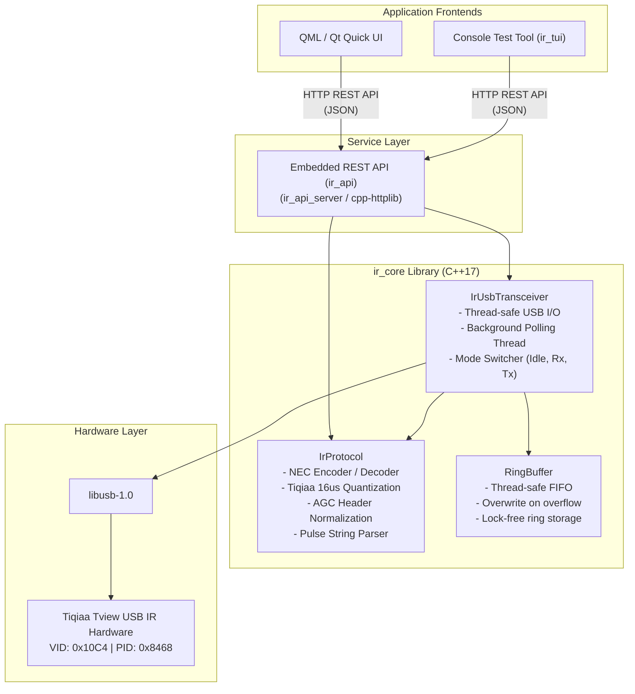

# `ir_core` — IR Transceiver & Protocol Engine

`ir_core` is a lightweight, high-performance, cross-platform C++17 static library for communicating with Infra-Red (IR) USB transceiver hardware, encoding and decoding IR signal timings, and managing thread-safe signal streaming.

Designed with **zero Qt dependencies**, `ir_core` relies strictly on the C++17 Standard Library and native `libusb-1.0`. It serves as the core driver and protocol engine powering graphical applications (Qt Quick/QML), embedded REST services (`ir_api`), and headless daemon tools.

---

## 📑 Table of Contents

- [Architecture Overview](#-architecture-overview)
- [Module Breakdown](#-module-breakdown)
  - [1. IrUsbTransceiver](#1-irusbtransceiver)
  - [2. IrProtocol & Data Models](#2-irprotocol--data-models)
  - [3. RingBuffer](#3-ringbuffer)
  - [4. SignalStorage & Remote Control Devices (RCD)](#4-signalstorage--remote-control-devices-rcd)
- [Hardware & USB Protocol](#-hardware--usb-protocol)
  - [USB Endpoints & Device ID](#usb-endpoints--device-id)
  - [Framing & Multi-Packet Fragmentation](#framing--multi-packet-fragmentation)
  - [Command Structure](#command-structure)
  - [Pulse Encoding & 16 µs Timebase](#pulse-encoding--16-µs-timebase)
  - [AGC Leader Mark Compensation](#agc-leader-mark-compensation)
- [Platform Support & Setup](#-platform-support--setup)
  - [Linux (udev Rules)](#linux-udev-rules)
  - [Windows (WinUSB)](#windows-winusb)
  - [Android (JNI & File Descriptor)](#android-jni--file-descriptor)
- [CMake Integration](#-cmake-integration)
- [Usage Examples](#-usage-examples)
  - [Opening Hardware & Transmitting a NEC Command](#opening-hardware--transmitting-a-nec-command)
  - [Transmitting Raw Pulse Sequences](#transmitting-raw-pulse-sequences)
  - [Single-Shot IR Capture (Blocking)](#single-shot-ir-capture-blocking)
  - [Continuous Background Polling (Asynchronous)](#continuous-background-polling-asynchronous)
  - [Android JNI File Descriptor Initialization](#android-jni-file-descriptor-initialization)
- [Building & Running Tests](#-building--running-tests)
- [License](#-license)

---

## 🏗 Architecture Overview



### Key Design Highlights

* **Independent & Portable:** No dependency on Qt; can be compiled into any native C++17 runtime.
* **Thread-Safe USB Access:** All USB hardware interactions (`m_devHandle`) are guarded by an internal mutex (`m_usbMutex`).
* **Non-Blocking Background Acquisition:** Background polling thread continuously gathers IR packets, normalizes pulses, and enqueues them into an internal `RingBuffer<IrSignal, 32>` while notifying subscribers via callbacks.
* **Microsecond Pulse Representation:** Consistent signed microsecond representation across the whole library:
  * **Positive duration (`+µs`):** MARK (Carrier burst active, IR LED ON).
  * **Negative duration (`-µs`):** SPACE (Carrier idle, IR LED OFF).

---

## 🧩 Module Breakdown

### 1. `IrUsbTransceiver`

Header: [`IrUsbTransceiver.h`](IrUsbTransceiver.h) | Source: [`IrUsbTransceiver.cpp`](IrUsbTransceiver.cpp)

The hardware driver for the Tiqiaa Tview USB transceiver. Manages device lifecycle, low-level USB endpoint transfers, hardware operating modes, signal transmission, and background polling.

#### Device Lifecycle & State
```cpp
enum class DeviceState {
    Disconnected,
    Idle,
    Receiving,
    Transmitting,
    Error
};

struct DeviceInfo {
    std::string manufacturer;
    std::string product;
    std::string serialNumber;
    uint16_t vendorId{0x10C4};
    uint16_t productId{0x8468};
    bool isConnected{false};
    uint8_t defaultFrequency{38}; // kHz
};
```

#### Primary Methods

| Method | Description |
| :--- | :--- |
| `bool openDevice()` | Opens USB device by VID (`0x10C4`) and PID (`0x8468`), detaches active kernel drivers, and claims interface `0`. |
| `bool openFromSysDevice(intptr_t sysFd)` | Wraps an existing OS file descriptor (used on Android via JNI `UsbDeviceConnection.getFileDescriptor()`). |
| `void closeDevice()` | Releases interface, closes handle, terminates any active polling threads. |
| `bool isConnected() const` | Returns `true` if USB device is open and interface is claimed. |
| `DeviceState getState() const` | Returns current operational state (`Disconnected`, `Idle`, `Receiving`, `Transmitting`, `Error`). |
| `DeviceInfo getDeviceInfo() const` | Returns queried USB descriptor metadata (manufacturer, product, serial number). |
| `std::string getFirmwareVersion()` | Queries hardware firmware string via `'V'` command. |
| `bool setIdle()` | Sets device to standby/idle mode (`'L'`). |
| `bool startReceive()` | Puts hardware into receive mode (`'R'`). |
| `bool startTransmit()` | Puts hardware into transmit mode (`'S'`). |
| `bool transmitIr(const std::vector<int>& pulses, uint8_t frequency_khz = 0)` | Encodes and sends raw pulse sequence via USB. Carrier frequency defaults to 38 kHz if set to 0. |
| `bool transmitIr(const IrSignal& signal)` | Transmits a structured `IrSignal`. |
| `bool captureOnce(IrSignal& outSignal, float timeoutSeconds = 10.0f)` | Synchronous blocking single-shot capture with configurable timeout. |
| `void startBackgroundPolling()` | Spawns a background worker thread that polls hardware buffer (`'O'`) and pushes captured signals to internal `RingBuffer`. |
| `void stopBackgroundPolling()` | Safely stops and joins the background polling thread. |
| `std::optional<IrSignal> popReceivedSignal()` | Pops the oldest received signal from internal ring buffer. |
| `void setSignalReceivedCallback(SignalReceivedCallback cb)` | Registers callback `void(const IrSignal&)` invoked whenever a signal is captured. |
| `void setStateChangedCallback(StateChangedCallback cb)` | Registers callback `void(DeviceState)` invoked on state transitions. |
| `void setLogCallback(LogCallback cb)` | Registers callback `void(const std::string&)` for internal diagnostic messages. |

---

### 2. `IrProtocol` & Data Models

Header: [`IrProtocol.h`](IrProtocol.h) | Source: [`IrProtocol.cpp`](IrProtocol.cpp)

Handles protocol encoding/decoding, hardware payload translation, AGC compensation, pulse string parsing, and protocol analysis.

#### Data Models

##### `IrSignal`
Represents an IR transmission or received sequence:
```cpp
struct IrSignal {
    std::vector<int> pulses;                                        // +mark, -space in microseconds
    uint8_t frequency_khz{38};                                      // Carrier frequency (default: 38 kHz)
    std::chrono::system_clock::time_point timestamp;                // Time of capture

    bool isValid() const;
    std::string toString() const;                                   // Formats pulses as CSV string
    static std::optional<IrSignal> parseString(const std::string& input, uint8_t defaultFreq = 38);
};
```

##### `DecodedCode` & `IrProtocolType`
Encapsulates high-level protocol data (e.g. NEC):
```cpp
enum class IrProtocolType {
    Raw,
    NEC,
    Sony,
    RC5,
    Unknown
};

struct DecodedCode {
    IrProtocolType protocol{IrProtocolType::Unknown};
    uint32_t address{0};
    uint32_t command{0};
    uint32_t rawValue{0};                                           // Full 32-bit decoded word
    size_t bitCount{0};
    bool isRepeat{false};                                           // True if NEC repeat code (~2.25 ms leader space)

    std::string protocolName() const;
    std::string toString() const;
};
```

#### Protocol Utility Methods

| Method | Description |
| :--- | :--- |
| `static void fixLeadingMark(std::vector<int>& pulses, bool verbose = false)` | Normalizes leading mark shortened by receiver AGC settling (e.g., ~6944 µs snapped to 9000 µs). |
| `static std::vector<uint8_t> encodeTiqiaaPayload(const std::vector<int>& pulses, uint8_t frequency_khz = 38)` | Encodes pulse array into Tiqiaa 16 µs timebase bytes. |
| `static bool decodeTiqiaaPayload(const std::vector<uint8_t>& payload, IrSignal& outSignal, bool verbose = false)` | Decodes USB frame starting with `'D'` and terminating with `'EN'`. Removes noise (< 50 µs) and merges contiguous states. |
| `static bool decodeNec(const std::vector<int>& pulses, DecodedCode& outCode)` | Decodes standard 32-bit NEC frame (9000 µs mark, 4500 µs space, LSB-first bitstream). Detects repeat frames. |
| `static std::vector<int> encodeNec(uint32_t address, uint32_t command)` | Generates complete 68-pulse NEC sequence (`Address`, `~Address`, `Command`, `~Command`, stop bit). |
| `static std::vector<int> parsePulseSequence(const std::string& inputStr)` | Parses brackets or comma-delimited string (e.g. `"[9000, -4500, 560, -560]"`). |
| `static std::string formatPulseSequence(const std::vector<int>& pulses)` | Serializes pulses to comma-separated text string. |

---

### 3. `RingBuffer`

Header: [`RingBuffer.h`](RingBuffer.h)

A fixed-capacity circular FIFO buffer designed for zero-allocation runtime passing of IR signals between the USB polling thread and UI/API consumers.

```cpp
template <typename T, size_t Capacity>
class RingBuffer;
```

* **Thread-Safe:** Operations are protected by an internal `std::mutex`.
* **Zero Allocation:** Stored in contiguous `std::array<T, Capacity>`.
* **Overwrite Policy:** When full, `push()` drops the oldest item and advances the tail pointer, ensuring incoming real-time signals are never dropped in favor of stale signals.
* **API:**
  * `bool push(const T& item)` / `bool push(T&& item)` — Returns `false` if an older element was overwritten.
  * `bool pop(T& outItem)` — Pops oldest item; returns `false` if empty.
  * `std::optional<T> pop()` — Returns oldest item as `std::optional`.
---

### 4. `SignalStorage` & Remote Control Devices (RCD)

Header: [`SignalStorage.h`](SignalStorage.h) | Source: [`SignalStorage.cpp`](SignalStorage.cpp)

Manages local JSON persistence for recorded IR signals organized into **Remote Control Devices (RCD)**. Handles multi-format schema migrations, timing-tolerant pulse sequence matching, and shell command triggers.

#### Data Models

##### `SavedIrSignal`
```cpp
struct SavedIrSignal {
    std::string name;                               // Friendly signal name (e.g. "TV Power")
    std::string protocol{"Raw"};                    // "Raw" or "NEC"
    uint8_t frequency_khz{38};                      // Modulation frequency (default: 38 kHz)
    std::string timestamp;                          // Timestamp string
    std::vector<int> pulses;                        // Microsecond pulse sequence (+mark, -space)
    std::string rawHex;                             // Decoded 32-bit hex (e.g. "0xE718FF00") or "N/A"
    std::string rcdName{"Default Remote Device"};   // Target Remote Control Device group
    std::string shellCommand;                       // Optional shell command executed upon signal match

    std::string toJsonString() const;
};
```

##### `RemoteControlDevice` (RCD)
```cpp
struct RemoteControlDevice {
    std::string name;                               // Device identifier (e.g. "Living Room TV")
    std::vector<SavedIrSignal> savedSignals;        // Commands belonging to this device
};

using RCD = RemoteControlDevice;
```

#### Primary Methods

| Method | Description |
| :--- | :--- |
| `static std::string getDefaultStoragePath()` | Computes platform storage path (`~/.config/IR/saved_ir_signals.json` on Linux, `%APPDATA%\IR\...` on Windows). |
| `bool loadFromFile(const std::string& path = "")` | Loads JSON database; automatically migrates legacy flat signal lists into RCD format. |
| `bool saveToFile(const std::string& path = "") const` | Persists all RCDs and their signals to the JSON storage file. |
| `const std::vector<RemoteControlDevice>& getDevices() const` | Returns all Remote Control Devices. |
| `bool addDevice(const std::string& name)` | Creates a new Remote Control Device group. |
| `bool removeDevice(const std::string& name)` | Deletes a Remote Control Device and all associated signals. |
| `bool renameDevice(const std::string& oldName, const std::string& newName)` | Renames an RCD and updates all contained signal entries. |
| `void addSignal(const SavedIrSignal& signal, const std::string& rcdName = "")` | Saves a new signal under the target RCD. |
| `bool updateSignal(size_t index, const SavedIrSignal& signal)` | Updates all properties of signal at flat `index` (Name, RCD, Protocol, Frequency, Hex, Pulses, Shell Command). |
| `bool removeSignal(size_t index)` | Removes signal at `index`; automatically prunes RCD if it becomes empty. |
| `std::optional<SavedIrSignal> findMatchingSignal(const IrSignal& signal) const` | Matches an incoming pulse train against stored signals using NEC decoded values and timing-tolerant pulse comparison (±25% tolerance). |

---

## ⚡ Hardware & USB Protocol

### USB Endpoints & Device ID

The driver communicates with the **Tiqiaa Tview USB IR Transceiver**:

* **Vendor ID (VID):** `0x10C4` (Silicon Laboratories)
* **Product ID (PID):** `0x8468`
* **Interface:** `0`
* **Default Endpoints:** `0x01` (OUT) and `0x81` (IN)

#### Dynamic Endpoint Auto-Discovery & Transfer Mode Detection
Older implementations attempted USB bulk transfers by default and only fell back to interrupt transfers upon receiving specific pipe errors. On ARM Linux (e.g., Raspberry Pi xHCI or DWC host controllers), submitting a bulk URB to a HID interrupt endpoint causes the kernel to fail immediately with `-EINVAL` (`LIBUSB_ERROR_INVALID_PARAM`), preventing the fallback from executing.

To guarantee seamless operation across x86 and ARM SBCs:
1. **Runtime Auto-Discovery (`discoverEndpoints()`):** On `openDevice()`, the driver reads the active USB configuration descriptor to query the actual endpoint addresses, transfer types (`LIBUSB_TRANSFER_TYPE_INTERRUPT` vs. `LIBUSB_TRANSFER_TYPE_BULK`), and `wMaxPacketSize`.
2. **Direct Transfer Execution:** The driver directly invokes `libusb_interrupt_transfer` (for standard CP2110 HID transceivers) or `libusb_bulk_transfer` (for CP2102/UART bridges) without guessing.
3. **Endpoint Stall & Clear-Halt Recovery:** If an endpoint stalls or encounters a pipe error (`LIBUSB_ERROR_PIPE` = -9) or buffer overflow (`LIBUSB_ERROR_OVERFLOW` = -12), the driver automatically invokes `libusb_clear_halt()` on that endpoint to recover the USB stack without freezing.
4. **Buffer Alignment:** Read buffers are padded to multiples of the endpoint's `wMaxPacketSize` (typically 64-byte multiples, e.g. 1024 bytes).

### Framing & Multi-Packet Fragmentation

USB transfers to/from the hardware are structured into report frames up to 64 bytes total. If a payload exceeds 56 bytes, it is split into multiple chunks with an inter-packet delay of 15 ms required by the hardware microcontroller:

```
+------------+------------+--------------------+---------------+----------------+-----------------------+
| Byte 0     | Byte 1     | Byte 2             | Byte 3        | Byte 4         | Bytes 5 .. (5 + N - 1)|
| Report ID  | Length     | Packet Counter     | Total Chunks  | Current Chunk  | Chunk Payload         |
| (0x02 OUT) | (N + 3)    | (1 .. 15)          | (1 .. M)      | (1 .. M)       | (Up to 56 bytes)      |
+------------+------------+--------------------+---------------+----------------+-----------------------+
```

### Command Structure

Application commands sent over USB are wrapped in an `ST` ... `EN` frame:

```
+-----------+-----------+--------------------+----------------+-------------------------+-----------+-----------+
| 'S' (0x53)| 'T' (0x54)| Command ID (1..200)| Command Char   | Extra Data (Optional)   | 'E' (0x45)| 'N' (0x4E)|
+-----------+-----------+--------------------+----------------+-------------------------+-----------+-----------+
```

#### Command Characters

| Command | Action | Description |
| :--- | :--- | :--- |
| `'L'` | **Standby / Idle** | Puts hardware transceiver into idle state. |
| `'R'` | **Receive Mode** | Activates the IR receiver sensor hardware. |
| `'S'` | **Transmit Mode** | Prepares hardware for transmitting an IR burst. |
| `'D'` | **Data / Transmit** | Transmits the encoded payload attached in Extra Data. |
| `'O'` | **Poll / Query** | Queries the hardware receive buffer for captured IR signal data. |
| `'V'` | **Firmware Version**| Requests the transceiver firmware identifier string. |

### Pulse Encoding & 16 µs Timebase

The hardware represents IR pulses using a **16 µs timebase resolution**:

$$\text{units} = \text{round}\left(\frac{|\text{duration in }\mu s|}{16.0}\right)$$

Each byte in the hardware payload stores:
* **Bit 7 (`0x80`):** Carrier State (`1` = MARK / ON, `0` = SPACE / OFF).
* **Bits 0–6 (`0x7F`):** Duration in units ($1 \dots 127$, i.e. up to $127 \times 16 = 2032\ \mu s$).

If a pulse duration exceeds 127 units ($2032\ \mu s$), it is segmented across multiple consecutive bytes carrying the same state bit:
* e.g., A 9000 µs MARK ($563$ units) is encoded as:
  * `0x80 | 127` (unit 1..127)
  * `0x80 | 127` (unit 128..254)
  * `0x80 | 127` (unit 255..381)
  * `0x80 | 127` (unit 382..508)
  * `0x80 | 55`  (unit 509..563)

### AGC Leader Mark Compensation

When an IR receiver (such as TSOP demodulators) transitions from idle to receiving a powerful burst, its internal **Automatic Gain Control (AGC)** takes $\sim 2\ ms$ to stabilize. This frequently causes the first pulse in a capture to be truncated from 9000 µs to ~6900 µs:

```
Measured:   [ +6944 µs , -4500 µs , +560 µs , -560 µs ... ]  <-- Truncated leader
Corrected:  [ +9000 µs , -4500 µs , +560 µs , -560 µs ... ]  <-- Restored standard NEC leader
```

`IrProtocol::fixLeadingMark()` detects when `pulses[0] < 8000` while `abs(pulses[1])` is in the 3500–5500 µs window, and automatically restores the leader mark to standard 9000 µs.

### Framing Validation & Ambient Noise Filtering

During continuous background monitoring or single-shot captures, raw incoming USB data is filtered through a multi-stage noise rejection engine to eliminate false triggers from high-gain receiver AGC:
* **Frame Header Verification:** In the Tiqiaa protocol, IR data is framed by `'S', 'T', <cmd_id>, 'D' ... 'E', 'N'`. The decoder strictly verifies the presence of the `'S', 'T'` header before `'D'` so that random bytes matching ASCII `'D'` (`0x44` = 1088 µs pulse) in data streams or status replies are never misinterpreted as the start of an IR packet.
* **Duration & Glitch Threshold:** Real IR commands and NEC repeat frames have at least 4,000 µs (4 ms) total duration. Short ambient light bursts (from fluorescent lamps, PWM dimmers, or Pi power ripple) with fewer than 8 pulses and total duration under 4,000 µs are automatically discarded.
* **High-Frequency Optical Hash Filter:** Legitimate IR commands have marks $\ge 350\ \mu\text{s}$ (or leaders $\ge 1500\ \mu\text{s}$). Sequences where all marks are $< 350\ \mu\text{s}$ are identified as high-frequency electrical or optical hash and rejected.
* **Multi-Gap Silence Rejection:** In any legitimate IR protocol, bits within a transmission are sent continuously with spaces $< 6,000\ \mu\text{s}$. A long pause ($> 8,000\ \mu\text{s}$) only occurs as the final trailing gap at the end of the frame. Any sequence containing 2 or more silence gaps $> 8,000\ \mu\text{s}$ (e.g. sporadic noise spikes separated by $10\dots 60\text{ ms}$ of silence) is automatically discarded as disjoint ambient noise.
* **Mark-to-Space Duty Cycle Check:** In ambient optical noise, total mark duration is very small compared to the total elapsed time ($< 8\%$ mark duty cycle). Real IR transmissions have mark duty cycles between $15\%$ and $60\%$. Sequences with $< 8\%$ duty cycle and no leader mark $\ge 2,000\ \mu\text{s}$ are discarded.
* **Dynamic Leader Scanning:** `IrProtocol::normalizeNec()` and `IrProtocol::decodeNec()` dynamically scan the incoming pulse stream to locate the genuine NEC leader ($9,000\ \mu\text{s}$ mark, $4,500\ \mu\text{s}$ space), making decoding immune to leading noise glitches that occur right before a button press.
* **Capture Mode Repeat Code Filtering:** During single-shot capture mode (`IrUsbTransceiver::captureOnce`), standalone NEC repeat frames (`9000, -2250, 560`) are automatically ignored so that the capture loop continues waiting until the user's complete 32-bit (68-pulse) command frame arrives.

---

## 💻 Platform Support & Setup

### Linux (udev Rules)

By default, Linux limits USB device access to the `root` user. To grant access to non-root users:

1. Create a udev rule `/etc/udev/rules.d/99-ir-usb.rules`:
   ```bash
   SUBSYSTEM=="usb", ATTR{idVendor}=="10c4", ATTR{idProduct}=="8468", MODE="0666", GROUP="plugdev"
   ```

2. Add your current user to the `plugdev` group:
   ```bash
   sudo usermod -aG plugdev $USER
   ```

3. Reload udev rules:
   ```bash
   sudo udevadm control --reload-rules && sudo udevadm trigger
   ```

> [!NOTE]
> `IrUsbTransceiver::openDevice()` automatically detaches any attached kernel driver (`libusb_detach_kernel_driver`) on Linux before claiming interface 0.

### Raspberry Pi & ARM Single-Board Computers (Pi 3, 4, 5, Zero 2 W)

When running on ARM Linux boards like the Raspberry Pi, consider the following hardware and kernel factors:

1. **Use USB 2.0 Ports (Black Ports):**
   * On Raspberry Pi 4 and 5, always plug the IR transceiver into a **USB 2.0 port (black)** instead of USB 3.0 (blue).
   * The VIA VL805 USB 3.0 controller on Pi 4 is known to introduce split-transaction scheduling overhead and microsecond timing jitter on Full-Speed interrupt endpoints.
2. **Power Rail Stability:**
   * IR receiver modules draw current surges when powering internal demodulators. Weak or noisy power supplies cause 5V rail ripple, which couples directly into the photodiode preamp and causes spurious "unknown" pulses.
   * Ensure your Raspberry Pi is powered by an official power supply, or isolate the transceiver with an externally powered USB 2.0 hub.
3. **Diagnostic Logging:**
   * Register a logging callback via `transceiver.setLogCallback(...)` or launch `ir_api_server` to view live endpoint auto-discovery logs:
     ```text
     [USB Driver] Discovered USB Endpoints: IN=0x81 (INTERRUPT, maxPacket=64B), OUT=0x01 (INTERRUPT, maxPacket=64B)
     ```
   * Any endpoint stalls or pipe errors are logged with automatic `libusb_clear_halt()` recovery messages.

### Windows (WinUSB)

Windows 10/11 will often bind the transceiver automatically. If `openDevice()` fails:
1. Download and run [Zadig](https://zadig.akeo.ie/).
2. Select `Options` -> `List All Devices`.
3. Locate `Tiqiaa USB IR` or device `10C4:8468`.
4. Install or replace the active driver with **WinUSB**.

### Android (JNI & File Descriptor)

SELinux blocks Android applications from directly opening `/dev/bus/usb`. Access must be delegated via Java:

1. Request device permission using Android's `UsbManager`.
2. Retrieve the native file descriptor:
   ```java
   UsbDeviceConnection connection = usbManager.openDevice(device);
   int sysFd = connection.getFileDescriptor();
   ```
3. Pass `sysFd` via JNI to C++:
   ```cpp
   ir::IrUsbTransceiver transceiver;
   transceiver.openFromSysDevice(static_cast<intptr_t>(sysFd));
   ```

---

## ⚙️ CMake Integration

Add `ir_core` to your project using CMake:

```cmake
# Add core library directory or include CMakeLists.txt
add_subdirectory(src/core) # If structured as subfolder

# Link ir_core to your executable or service
target_link_libraries(my_application PRIVATE
    ir_core
)
```

The `ir_core` target exposes its include directory (`$<BUILD_INTERFACE:${CMAKE_CURRENT_SOURCE_DIR}/src/core>`) publicly, allowing consuming code to directly include headers:

```cpp
#include "IrUsbTransceiver.h"
#include "IrProtocol.h"
#include "RingBuffer.h"
```

---

## 📖 Usage Examples

### Opening Hardware & Transmitting a NEC Command

```cpp
#include "IrUsbTransceiver.h"
#include "IrProtocol.h"
#include <iostream>

int main() {
    ir::IrUsbTransceiver transceiver;

    // Connect to hardware
    if (!transceiver.openDevice()) {
        std::cerr << "Failed to connect to IR transceiver hardware.\n";
        return 1;
    }

    std::cout << "Hardware Version: " << transceiver.getFirmwareVersion() << "\n";

    // Encode a standard NEC command (Address 0x00, Command 0x18 -> TV Power)
    uint32_t address = 0x00;
    uint32_t command = 0x18;
    std::vector<int> pulses = ir::IrProtocol::encodeNec(address, command);

    // Transmit at standard 38 kHz modulation
    if (transceiver.transmitIr(pulses, 38)) {
        std::cout << "Successfully transmitted NEC command 0x" << std::hex << command << "\n";
    }

    transceiver.closeDevice();
    return 0;
}
```

---

### Transmitting Raw Pulse Sequences

```cpp
#include "IrUsbTransceiver.h"
#include "IrProtocol.h"
#include <iostream>

int main() {
    ir::IrUsbTransceiver transceiver;
    if (!transceiver.openDevice()) return 1;

    // Parse timing sequence from text or config file
    std::string sequence = "[9000, -4500, 560, -560, 560, -1690, 560, -40000]";
    auto signalOpt = ir::IrSignal::parseString(sequence, /*defaultFreq=*/38);

    if (signalOpt) {
        std::cout << "Transmitting " << signalOpt->pulses.size() << " pulses...\n";
        transceiver.transmitIr(*signalOpt);
    }

    transceiver.closeDevice();
    return 0;
}
```

---

### Single-Shot IR Capture (Blocking)

```cpp
#include "IrUsbTransceiver.h"
#include "IrProtocol.h"
#include <iostream>

int main() {
    ir::IrUsbTransceiver transceiver;
    if (!transceiver.openDevice()) return 1;

    std::cout << "Point your remote control at the transceiver and press a button...\n";

    ir::IrSignal signal;
    if (transceiver.captureOnce(signal, /*timeoutSeconds=*/10.0f)) {
        std::cout << "Captured " << signal.pulses.size() << " pulses at " 
                  << (int)signal.frequency_khz << " kHz!\n";
        std::cout << "Pulses: " << signal.toString() << "\n";

        // Attempt NEC protocol decoding
        ir::DecodedCode decoded;
        if (ir::IrProtocol::decodeNec(signal.pulses, decoded)) {
            std::cout << "Decoded: " << decoded.toString() << "\n";
        } else {
            std::cout << "Protocol: Raw / Unrecognized\n";
        }
    } else {
        std::cout << "Capture timed out.\n";
    }

    transceiver.closeDevice();
    return 0;
}
```

---

### Continuous Background Polling (Asynchronous)

```cpp
#include "IrUsbTransceiver.h"
#include "IrProtocol.h"
#include <iostream>
#include <thread>
#include <chrono>

int main() {
    ir::IrUsbTransceiver transceiver;
    if (!transceiver.openDevice()) return 1;

    // Optional: Log callback
    transceiver.setLogCallback([](const std::string& msg) {
        std::cout << "[USB LOG] " << msg << "\n";
    });

    // Register async reception callback
    transceiver.setSignalReceivedCallback([](const ir::IrSignal& sig) {
        std::cout << "\n>>> [ASYNC RX] Received signal with " << sig.pulses.size() << " pulses!\n";
        ir::DecodedCode code;
        if (ir::IrProtocol::decodeNec(sig.pulses, code)) {
            std::cout << "    " << code.toString() << "\n";
        }
    });

    // Start background receiver worker thread
    transceiver.startBackgroundPolling();
    std::cout << "Background polling active. Listening for signals (press Enter to stop)...\n";

    std::cin.get();

    // Alternatively, pop directly from ring buffer if not using callback:
    // while (auto sig = transceiver.popReceivedSignal()) { ... }

    transceiver.stopBackgroundPolling();
    transceiver.closeDevice();
    return 0;
}
```

---

### Android JNI File Descriptor Initialization

```cpp
#include "IrUsbTransceiver.h"
#include <jni.h>

extern "C" JNIEXPORT jboolean JNICALL
Java_com_example_ir_MainActivity_nativeInitUsb(JNIEnv* env, jobject thiz, jint sysFd) {
    static ir::IrUsbTransceiver transceiver;

    // Wrap Android's sysFd through libusb_wrap_sys_device
    bool success = transceiver.openFromSysDevice(static_cast<intptr_t>(sysFd));
    return success ? JNI_TRUE : JNI_FALSE;
}
```

---

## 🧪 Building & Running Tests

Unit tests for `ir_core` are implemented in [`tests/test_core.cpp`](../../tests/test_core.cpp) and cover:

* `RingBuffer` operations, FIFO semantics, and overwrite behavior
* `IrProtocol` pulse string parsing and formatting
* AGC leader mark correction
* Tiqiaa payload byte encoding and decoding roundtrip
* NEC protocol encode & decode verification
* `IrUsbTransceiver` lifecycle and state machine
* SignalStorage support and tolerant pulse matching

### Running via CTest
```bash
cmake --build build/debug --target test_ir_core
ctest --test-dir build/debug --output-on-failure
```

### Running Test Binary Directly
```bash
./build/debug/test_ir_core
```

---

## 📄 License

Part of the **Multi-Platform IR Transceiver Application**. Distributed under the MIT License.
